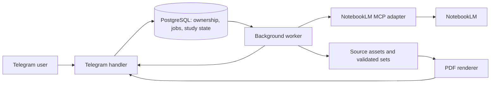

# NotebookLM Telegram study bot

Status: design target with a first implementation in `src/studybot`. See [README.md](README.md) for setup, verified behavior, and current limits. Live Telegram/Google credentials have not been configured.

## Product defaults

- Private chats initially.
- Each incoming media message creates a new notebook, owned in the bot database by the sending Telegram user. Forwarding is optional; ordinary uploads work too. Forward-origin metadata never determines ownership.
- An album is collected into one submission and one notebook, with one source per item.
- MCQs and flashcards are generated independently, on demand.
- Before either generation starts, let the user configure item count and difficulty. Default to 20 items and medium difficulty. Treat item count as a request and display the actual validated count returned.
- Language is always English for bot messages, generated MCQs, flashcards, explanations, and PDFs, regardless of source language. There is no language selector.
- Default to Telegram's standard Bot API when no endpoint is configured. Production can use the user's existing self-hosted Bot API on the same VPS, with access to its downloaded files.
- One active study session per user. Previous results and generated sets remain available.
- Start with a dedicated operator Google account, an allowlist, and conservative concurrency. A public service needs an explicit account/quota model; notebooks in this initial design share the operator's Google account.

## Conversation

The bot replies to a submission with one persistent control message. It edits this message as work advances; study items and PDF files are separate messages.

```text
📘 Cardiology.pdf
Receiving file…
```

Progress stages:

```text
Queued → Downloading → Creating notebook → Uploading → Processing source → Ready
```

Show byte progress where instrumentation provides it. For NotebookLM processing, show the stage and elapsed time unless the server actually supplies a percentage. Never manufacture progress percentages. Upload completion alone does not mean the source is ready for generation.

Once all sources are ready:

```text
📘 Cardiology.pdf
Source ready. What would you like to generate?

[Open Notebook]
[Generate MCQs]       [Generate flashcards]
```

After source upload, enable read-only link sharing and store the returned notebook URL. Show the clickable link and an `Open Notebook` URL button as soon as sharing succeeds, even if source processing is still running. Keep this button on all subsequent control-message screens, including generation settings and failures. Generation becomes available only after processing completes.

With the dedicated operator account, an owner-only URL would not give the Telegram user access. Use `Anyone with a link` viewer access for this design; the notebook and its sources are accessible to link holders signed into Google. Use a consumer account that supports this sharing mode. If sharing fails, keep source processing and generation available, show `Notebook link unavailable`, and offer a sharing retry instead of an inaccessible button. See [Google's public notebook sharing documentation](https://support.google.com/gemininotebook/answer/16322204) and [account restrictions](https://support.google.com/gemininotebook/answer/16757456?hl=en).

### Generation settings

Clicking `Generate MCQs` or `Generate flashcards` opens settings in the control message before any generation job is created:

```text
Generate flashcards
Number of Cards: 20
Level of Difficulty: Medium
Language: English

[10] [20 ✓] [30] [50] [Custom count]
[Easy] [Medium ✓] [Hard]
[Generate] [Back]
[Open Notebook]
```

For MCQs, label the count `Number of Questions`; for flashcards, use `Number of Cards`. Custom count accepts a positive integer within the supported range established during the MCP integration spike. Reject invalid input with an inline explanation. Map counts to backend presets if exact counts are unsupported, and explain that mapping before confirmation.

Settings are separate drafts per user, submission, and artifact kind. Clicking `Generate` validates and snapshots count, difficulty, and fixed `language=en` into the job and study-set version. `Back` discards the draft without starting work. Use supported language settings and explicit English generation instructions; validate output language before publishing and report a generation error if it cannot be corrected. Apply the same settings to image-card enrichment and PDF rendering. During configuration for one artifact, preserve access to any already-ready artifact.

After MCQs finish:

```text
📘 Cardiology.pdf
MCQs ready: 20 questions

[Open Notebook]
[Start MCQs]          [MCQs PDF]
[Generate flashcards]
```

Once both sets exist:

```text
[Open Notebook]
[Start MCQs]          [MCQs PDF]
[Start flashcards]    [Flashcards PDF]
```

Each artifact has its own queued/generating/ready/failed state. Generating flashcards must not remove access to ready MCQs. Repeated confirmation clicks return the existing job for the same settings draft. Failures update the control message with a useful reason and a retry action, retaining the confirmed settings.

## MCQ exam

1. Create a persisted session with a fixed set version and question order.
2. Send a separate exam control message: `Question 1/20 · Answered 0/20 · Correct 0` with a `Leave exam` button.
3. Send one non-anonymous quiz poll for the current question. Configure one correct answer for this product's MCQs and prevent revoting where supported.
4. On the first valid answer from the session owner, atomically record the answer and score. Close the poll, show the explanation, update progress, and send the next question.
5. At completion, show score, answered count, and elapsed time, with `Review incorrect` and `Restart` actions.

Leaving an exam closes the active poll, prevents further progression, and preserves the session. Offer `Resume exam` and `Back to notebook`. Resuming an unanswered closed question sends a new poll for the same question. Track poll attempts separately from the logical question.

Deduplicate answer events and serialize session changes. If leaving and answering race, the committed session state determines whether the answer counts. Ignore answers to obsolete polls and answers from another user.

Validate poll content before a set becomes ready. For long clinical stems, send the complete stem in a preceding message and use a short poll question. For long options, send a labeled option list and put A/B/C/D in the poll. Do not truncate educational content or alter the correct-answer mapping.

## Flashcard review

Send one new card message after each rating, leaving a browsable history in chat. This gives the requested list of messages without flooding the conversation with the entire deck at once.

```text
Card 3/20 · Got it 2 · Missed it 0

What structure is highlighted?

Answer: [spoiler text]

[✅ Got it]           [❌ Missed it]
[Leave review]
```

For text answers, use an HTML spoiler after escaping generated text. A question image is visible; an answer image is spoiler-covered. If a card needs both, send a visible question image and a separate answer image, associating all messages with the same card attempt. Long captions become separate text messages.

Record one rating per attempt and remove its rating buttons afterward. Persist missed cards for a `Review missed` session. Spoiler reveal is not a grading signal: the explicit rating buttons advance the review.

### Image support

Do not assume a NotebookLM flashcard export includes original figures or usable image references. Verify the chosen server's actual export schema during the integration spike.

Keep originals and build an asset catalog:

- Standalone images become source assets directly.
- PDFs provide extracted figures or rendered page crops, retaining page number and bounding box.
- Slides and other illustrated documents need format-specific image extraction or page rendering.
- Audio has no source figures. Video frame cards require an explicit frame-extraction and matching feature.

Every image asset gets a stable ID, storage key, source ID, locator, and optional description. Enrich cards by matching their topic and source evidence to catalog assets. This may require a separate vision model; NotebookLM remains the source for the study content. If matching is uncertain, keep a valid text card rather than attach an unrelated image. Image-dependent cards must pass validation with an accessible asset before publication.

Store front and back images separately. Use verified source images rather than generating substitute educational diagrams. Image extraction and matching are required implementation work for the image feature, not an assumed MCP capability.

## PDF outputs

Build PDFs from the same validated set used in Telegram:

- MCQs PDF: questions and options first, followed by an answer key and explanations.
- Flashcards PDF: numbered fronts followed by a matching answer section, including any front/back images.

Generate on first request, cache by set version, and send as a document. PDF answers are plainly printed; chat spoiler behavior does not carry into a PDF. All text is English; embed suitable fonts. Split oversized PDFs into numbered volumes.

## Backend

Proposed stack: Python with aiogram for Telegram updates, an MCP client adapter, PostgreSQL for durable state and jobs, local persistent storage initially, and an HTML-to-PDF renderer. Run the Telegram handler, job worker, and MCP server as separate services on a persistent host. Add object storage when deploying beyond one host.

### Existing Telegram Bot API deployment

Connect to the user's self-hosted Bot API server on the VPS; provisioning another server is outside this plan. Configure its API base URL, file URL or shared-file mapping, and bot token through deployment settings. Route file downloads and normal bot calls through this endpoint. Verify the existing server's version and whether it runs in local mode before relying on its large-file behavior.

If the API server returns local file paths, the bot worker must share that filesystem or use an authenticated transfer path from the VPS. Do not assume a VPS-local path exists on a worker hosted elsewhere. The integration check must cover both receiving a large source file and sending a generated PDF through the existing server.



Keep the Telegram handler fast: persist the update and job, then acknowledge it. Workers perform downloads, NotebookLM calls, asset extraction, normalization, and PDF rendering. Claim jobs with database leases, bounded retries, and backoff. Reconcile upstream work after ambiguous timeouts before retrying notebook or artifact creation.

The MCP adapter should expose application-level operations rather than spread tool names throughout the bot:

```text
create_notebook(title) -> notebook_id
add_source(notebook_id, local_file) -> source_id
enable_notebook_link_sharing(notebook_id) -> notebook_url
get_source_state(notebook_id, source_id) -> processing | ready | failed
start_generation(notebook_id, source_ids, kind, settings) -> artifact_id
get_generation_state(notebook_id, artifact_id) -> running | ready | failed
download_set(notebook_id, artifact_id, kind) -> raw export
```

These are proposed internal interfaces, not claims about exact MCP signatures. Pin the server version, inspect its tool schemas, and map them in one adapter. Share a restricted upload directory with a local MCP process so it can access files; a remote server needs a verified transfer mechanism.

## Persistent records

| Record | Important fields |
|---|---|
| User | Telegram ID, account/profile mapping |
| Submission | Owner ID, chat ID, control message ID, notebook ID, notebook URL, sharing state, status |
| Source | Submission ID, Telegram file ID, original name, detected MIME, storage key, NotebookLM source ID, state |
| Job | Operation, target ID, state, lease, retry count, upstream identifiers, error |
| Study set | Submission ID, kind, artifact ID, version, settings, validated items, PDF key |
| Generation draft | Owner ID, submission ID, artifact kind, requested count, difficulty, fixed language `en`, revision |
| Asset | Source ID, storage key, locator/page/crop, media type |
| Session | Owner ID, set version, kind, order, cursor, state, timestamps |
| Attempt | Session ID, item ID, poll/message IDs, answer/rating, correctness |
| Processed update | Telegram update ID, processing state |

MCQ items contain a stable ID, stem, options, correct option index, explanation, and optional source references. Flashcards contain a stable ID, front/back text, front/back asset IDs, and optional references. Preserve raw exports separately for adapter debugging. Never invent missing source references.

## Ingestion and operating rules

- Use the screenshot's extensions as the initial requested coverage list. Check file signatures as well as names, and verify each format against the installed MCP/backend. The UI's accepted-extension list is not proof that every upload path supports every format.
- Accept documents, photos, audio, voice notes, videos, and video notes when they map to a verified source format. Preserve original files where Telegram provides them; recommend sending images as documents when original resolution matters.
- For forwarded media without accessible bytes, ask for an ordinary file upload. Do not depend on forward-origin metadata.
- Use the existing self-hosted Telegram Bot API server on the VPS for large lecture recordings. Apply NotebookLM's source limits independently.
- Use short opaque callback IDs; resolve ownership and state from the database. Check the sender on every action.
- Persist exact source/artifact IDs and set versions so concurrent requests never download another job's latest output.
- Throttle message edits and respect Telegram retry delays. If the control message was deleted, create a replacement and persist its ID.
- Treat unsupported media, source processing errors, expired Google authentication, account quotas, malformed exports, and generation timeouts as distinct errors with appropriate retry behavior.
- Restrict access to the shared Google profile and stored source files. Define retention and provide a delete action covering local assets, generated files, and the associated NotebookLM notebook.

## Integration baseline and verified constraints

Use [jacob-bd/notebooklm-mcp-cli](https://github.com/jacob-bd/gemini-notebook-mcp-cli), which now uses the Gemini Notebook name. Its [MCP guide](https://raw.githubusercontent.com/jacob-bd/gemini-notebook-mcp-cli/main/docs/MCP_GUIDE.md) documents notebook creation, file-source upload, Studio creation/status, and artifact download. Validate quiz/flashcard JSON and source readiness against the pinned release before implementation relies on them. No NotebookLM MCP connection is available in this workspace yet.

The [Telegram Bot API](https://core.telegram.org/bots/api) documents a 20 MB cloud download limit; the local server removes that download limit. Non-anonymous polls supply user answer updates. Spoilers are supported for text and photos. Poll and caption length constraints require validation and overflow messages.

[Google's source documentation](https://support.google.com/gemininotebook/answer/16215270) currently states up to 200 MB or 500,000 words per uploaded source. It documents images and common document formats, audio, EPUB, and other source types. Validate the screenshot's less common formats through actual uploads rather than promising blanket compatibility.

## Build order and acceptance criteria

1. Integration spike: authenticate a dedicated Google profile; create a notebook; upload representative PDF, image, audio, and document files; observe readiness; enable viewer link sharing and open the URL from a different Google account; generate and download a quiz and flashcards; verify supported count/difficulty controls, English output, JSON, source references, and image fields.
2. Ingestion and control message: verify a source never offers generation before processing completes, a repeated update does not create duplicate work, and `Open Notebook` remains available after upload and across later screens. Exercise sharing failure and retry. Verify both generation settings flows, custom count validation, draft isolation, cancellation, and duplicate confirmation handling.
3. Study sets and MCQs: verify correct-answer mapping, long stems/options, progress, leave/resume, duplicate votes, and restarts during an exam.
4. Flashcards and assets: verify spoilers, front/back images, uncertain image matches, repeated ratings, and review of missed cards.
5. PDF output and recovery: inspect pagination, image placement, answer keys, and English-only output, including for non-English source files; verify cached output matches its set version and jobs recover after a worker restart.
6. Deployment: connect to the existing Bot API server on the VPS; exercise large-file downloads, cross-host file access if needed, PDF sends, quota/authentication failures, ownership checks, deletion, and backup/recovery.

Completion means a forwarded source can traverse ingestion, both generation paths, interactive study, and matching PDF export, including an illustrated flashcard example and interrupted-session recovery.
